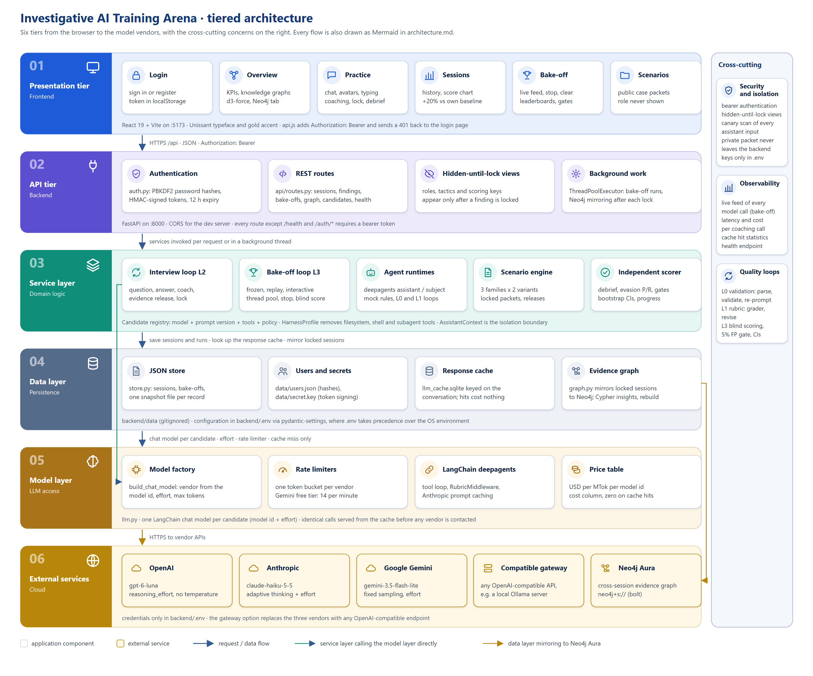

# Investigative AI Training Arena

A text-based training arena where investigators practice interviews with simulated subjects while competing
AI assistants coach them. Built for the Unissant use case "Investigative AI Training Arena: Multi-Agent
Interview Coaching and Evaluation".

- **Backend:** Python 3.12, FastAPI, [LangChain deepagents](https://docs.langchain.com/oss/python/deepagents).
- **Models:** hosted APIs from three vendors, one candidate per model: `gpt-6-luna` (OpenAI), `claude-haiku-5-5`
  (Anthropic) and `gemini-3.5-flash-lite` (Google Gemini). Any OpenAI-compatible gateway (e.g. a local Ollama
  server) still works. The provider and model list are chosen in `backend/.env`.
- **Login:** username and password accounts (a seeded trainer account plus self-registration); every API route
  except `/api/health` and `/api/auth/*` needs a bearer token.
- **Frontend:** React 19 + Vite.
- **Runs offline:** with no model credentials every candidate falls back to a deterministic mock runtime,
  so the full interview, debrief and bake-off flows (and the test suite) work with no model calls.

All cases, people, companies and records are synthetic.

Docs: [architecture.md](architecture.md) (components, loops, engineering disciplines) and [app_usage.md](app_usage.md) (how to use the app, with flow diagrams).



Tiers: presentation (React), API (FastAPI + auth), service layer (loops, agents, scenario engine, scorer), data layer
(JSON store, users, response cache, evidence graph), model layer (vendor dispatch, rate limiters, deepagents) and the
external services. A compact component view is in [docs/architecture-overview.png](docs/architecture-overview.png).
`docs/make_tiers_diagram.py` generates the tiered SVG; the PNGs are browser renders so they look the same everywhere.

## Quick start

One command for both servers (creates the venv and installs frontend dependencies on first run):

```bash
./start.sh          # backend :8000 + frontend :5173, logs and pids in .run/
./stop.sh           # stop both (./start.sh backend | ./stop.sh frontend for one side)
```

Manual steps:

```bash
# backend
cd backend
uv venv --python 3.12 .venv && .venv/bin/python -m pip install -r requirements.txt   # or: uv pip install -r requirements.txt
cp .env.example .env            # set OPENAI_API_KEY / ANTHROPIC_API_KEY / GEMINI_API_KEY (or a gateway URL + key)
./run_dev.sh                    # http://localhost:8000  (OpenAPI docs at /docs)

# frontend (second terminal)
cd frontend
npm install
npm run dev                     # http://localhost:5173  (proxies /api to :8000)

# tests
cd backend && .venv/bin/python -m pytest -q
```

`run_dev.sh` calls the venv interpreter by path on purpose: a shell alias for `python` can otherwise bypass the venv.

## How it maps to the challenge

| Challenge requirement | Where it lives |
|---|---|
| Investigative assistants that flag gaps/contradictions with transcript evidence and suggest neutral follow-ups | `backend/app/agents/llm.py` (`DeepAgentAssistant`), prompt in `app/agents/prompts.py`, baseline rules in `app/agents/mock.py` |
| Simulated subjects playing truthful or deceptive roles from a private profile | `DeepAgentSubject`, `MockSubject`; private packets in `app/scenarios/library.py` |
| Scenario engine: locked facts, scripted evidence release, hidden role labels and scoring keys | `app/scenarios/engine.py`; three packets per case (public / private subject / evaluator-only) |
| Independent scoring of the locked finding against hidden facts | `app/scoring/scoring.py` |
| Practice vs assessment modes | `Session.mode`; the API withholds coaching in assessment mode until the finding is locked |
| Bake-off: 3 assistants × 3 subjects, replay then interactive track, blinded scoring | `app/loops/bakeoff_loop.py` |
| Isolation (no access to hidden answers) and 5% false-positive gates, then rank on recall and questioning | `aggregate_assistants` in `app/scoring/scoring.py` |
| Investigator improvement vs own baseline (+20%) | `investigator_progress`; Sessions page |
| Case-level clustering in confidence intervals, role prevalence disclosure | `cluster_bootstrap_recall_ci`, `BakeoffRun.role_prevalence` |

## Loop engineering

The arena is organised as five nested, bounded loops. Each has an explicit budget, exit condition and measurement.

| Loop | What iterates | Budget / exit | Code |
|---|---|---|---|
| **L0 Validation loop** | Model output → parse → validate as a Pydantic schema → re-prompt with the error | 2 retries, then raise | `app/agents/validation_loop.py` |
| **L1 Rubric loop** | deepagents `RubricMiddleware`: a grader model checks the assistant's coaching against a rubric (exact turn citations, no demeanor inference, neutral follow-up) and the assistant revises | `rubric_max_iterations` per candidate policy | `DeepAgentAssistant._agent` |
| **L2 Interview loop** | question → subject answer → assistant assessment → scripted evidence release → budget check → commit → score | `max_turns` exchanges; ends when a finding is locked | `app/loops/interview_loop.py` |
| **L3 Bake-off loop** | frozen transcripts → replay track → interactive cross-pairing → blind scoring → gates → leaderboards | cases × candidates × repeats × tracks, randomised order | `app/loops/bakeoff_loop.py` |
| **L4 Investigator loop** | each locked session updates the investigator's questioning score against their own first session | target +20% | `investigator_progress` |

## Agents (deepagents)

Both agent categories are built with `create_deep_agent`:

- **Assistant** gets three read-only tools (`lookup_turn`, `list_released_evidence`, `get_case_packet`) so every
  flag can quote an exact turn. A `HarnessProfile` removes deepagents' default filesystem, shell and subagent tools.
  The candidate policy decides the model, effort and whether the rubric loop is on.
- **Subject** gets its private packet in the system prompt and reports a `tactic` for each turn
  (`truthful | uncertain | omission | deflection | minimisation | contradiction`). The scorer uses those labels as
  evasion-event ground truth; they are never shown to assistants. Behaviour outside the permitted list, or
  disclosure of a must-not-disclose fact, is a fidelity failure, not successful evasion.
- Models are built by `build_chat_model` in `app/agents/llm.py`:
  - `ARENA_PROVIDER=cloud` (default when a vendor key is set): the vendor is inferred from each id in
    `ARENA_MODELS`. `gpt-*` -> `ChatOpenAI` (reasoning model: no temperature, the candidate's `effort` maps to
    `reasoning_effort`); `gemini-*` -> `ChatGoogleGenerativeAI` (fixed sampling, `effort` -> `reasoning_effort`);
    `claude-*` -> `ChatAnthropic` with adaptive thinking and explicit `effort` (server-side refusal fallbacks on
    Opus/Sonnet; Haiku 5.5 has none and rejects the parameter). The first model is the rubric grader unless
    `ARENA_GRADER_MODEL` says otherwise.
  - `ARENA_PROVIDER=openai_compatible`: `ChatOpenAI` pointed at `ARENA_OPENAI_BASE_URL` with `ARENA_OPENAI_MODEL`
    (tested with `gpt-oss-20b` and local Ollama models). `effort` maps to `reasoning_effort` on gpt-oss only.
  - `ARENA_PROVIDER=mock`: deterministic rule-based runtimes, no network.
- Observed on the hosted models (low effort, one exchange, 2026-11-06): coaching took about 5 s on
  `claude-haiku-5-5`, 8 s on `gpt-6-luna` and 10 s on `gemini-3.5-flash-lite`; the rubric-loop candidate takes
  several times longer because the grader re-runs the agent. The leaderboard publishes both latencies.

Candidates are versioned combinations of model + prompt version + tool configuration + policy
(`app/agents/candidates.py`): per configured model one `asst-<model>-v1` coach (evidence-first prompt, low effort,
no rubric loop; identical prompt, tools and budget across models) and one `subj-<model>-v1` subject, plus
`asst-<model>-rubric-v1` on the first model (deepagents RubricMiddleware self-evaluation, medium effort), plus the
mock baselines below. Two deterministic baselines ship on purpose: an evidence-first rule set that respects
the false-positive constraint, and an aggressive rule set that treats uncertainty as evasion and is expected to
fail the 5% gate.

## Isolation

`AssistantContext` is the boundary: it is built only from the public packet, the transcript and released
records. Every string an assistant receives is logged to `Session.assistant_inputs`; the scorer scans that log for
evaluator-only canary strings (role markers, private objectives). A candidate that fails the check is ineligible.

## Scoring summary

- **Role score:** 2×3 matrix (truthful/deceptive × truthful/deceptive/insufficient), deceptive recall with a
  family-clustered bootstrap CI, false-positive rate with unresolved truthful cases kept in the denominator, PPV,
  unresolved rates by role.
- **Evasion events:** precision/recall of `possible_evasion`, `non_responsive` and `contradiction` flags against
  the subject's tactic labels; flags with no quote or a non-existent turn count as unsupported.
- **Questioning quality (proxy):** topic coverage × (1 − unsupported-flag rate). The five-dimension trainer rubric
  (0–4 each, ×5) is entered by a blinded trainer on the debrief screen and must be calibrated locally before use.
- **Subjects:** fidelity (compliant turns / all turns) reported separately for truthful and deceptive runs,
  invalid sessions, deceptive success (undetected within budget while compliant), misleading clearance, unresolved.
- **Eligibility:** false-positive rate ≤ 5% and isolation pass. Eligible candidates rank by recall, then
  questioning quality. Cost and latency are published alongside rank.

## API

| Method | Path | Purpose |
|---|---|---|
| GET | `/api/health` | provider, model ids, case count (public, no login) |
| POST | `/api/auth/login` · `/api/auth/register` | username + password -> bearer token (public) |
| GET | `/api/auth/me` | the signed-in user |
| GET | `/api/scenarios` | public packets only |
| GET | `/api/candidates?kind=assistant\|subject` | candidate specs and their effective runtime |
| POST | `/api/sessions` | start (mode, case or random, assistant, subject, budget) |
| POST | `/api/sessions/{id}/ask` | one exchange; coaching returned only in practice mode |
| POST | `/api/sessions/{id}/finding` | lock the finding; returns the debrief with revealed facts |
| POST | `/api/sessions/{id}/trainer-rating` | blinded trainer rubric |
| GET | `/api/investigators/{name}/progress` | baseline vs recent sessions |
| POST | `/api/bakeoffs` | start a tournament (runs in the background) |
| GET | `/api/bakeoffs/{id}?include_results=true` | status, leaderboards, per-trial results |
| POST | `/api/bakeoffs/{id}/stop` | stop a queued or running bake-off (status becomes `cancelled`) |
| GET | `/api/graph/status` · `/insights` · `/sessions` | Neo4j connection, cross-session queries, node/link graph (503 when not configured) |
| POST | `/api/graph/rebuild` | mirror every locked session into Neo4j |
| DELETE | `/api/bakeoffs` · `/api/bakeoffs/{id}` | clear every finished bake-off, or delete one |

## Project layout

```
backend/app
  config.py            settings (provider auto|cloud|openai_compatible|mock, model list, vendor keys)
  auth.py              login: PBKDF2 password hashes in data/users.json, HMAC-signed bearer tokens
  graph.py             optional Neo4j mirror of locked sessions + cross-session Cypher queries
  schemas.py           all Pydantic models
  scenarios/           library.py (3 families × 2 variants), engine.py
  agents/              context.py (isolation boundary), llm.py (deepagents, rate limiters), cache.py, mock.py, candidates.py,
                       prompts.py, profiles.py, validation_loop.py
  loops/               interview_loop.py (L2), bakeoff_loop.py (L3)
  scoring/scoring.py   debrief, trial results, leaderboards, bootstrap CI, progress
  api/routes.py        FastAPI routes;  main.py app factory
backend/tests          42 tests, all runnable offline
frontend/src           login page + sidebar app shell; pages: Login, Home (KPIs + knowledge graphs), Practice (stepper), Sessions (progress chart),
                       Bakeoff (leaderboards), Scenarios; components: KnowledgeGraph (d3-force), ScoreChart, Coaching, Debrief
```

## Adding a case family

Add a matched truthful and deceptive `Scenario` pair to `app/scenarios/library.py`. Keep communication style
independent of role, give every `question_bank` entry keywords that resolve to its own topic (a test enforces this),
and list only evaluator-only strings as `isolation_canaries`. Put new families on the `hidden` split so they never
appear in development prompts or tuning.

## Hosted three-model bake-off (OpenAI, Anthropic, Gemini)

The default configuration registers one assistant and one subject candidate per hosted model, with the same
prompt, effort and tools, so only the model differs. `backend/.env`:

```
ARENA_PROVIDER=cloud
ARENA_MODELS=gpt-6-luna,claude-haiku-5-5,gemini-3.5-flash-lite
OPENAI_API_KEY=sk-...
ANTHROPIC_API_KEY=sk-ant-...
GEMINI_API_KEY=...
```

A model whose vendor key is missing is listed but greyed out (`available: false` with the reason) and refused with
`409` at session start. Per-model cost on the leaderboard uses the price table in `app/agents/llm.py`.

## Throughput and the response cache

- Every model response is stored in `backend/data/llm_cache.sqlite`, keyed on the exact prompt plus the model's
  parameters. Replayed transcripts, repeated trials and re-runs of the same cases are answered from disk; cache hits
  report zero tokens and zero cost. `ARENA_LLM_CACHE=false` disables it; delete the file to start fresh.
- Bake-off trials are independent, so each phase runs `ARENA_BAKEOFF_WORKERS` (default 4) of them concurrently;
  the live feed lists every trial in flight.
- One request-rate limiter per vendor (`ARENA_OPENAI_RPM`, `ARENA_ANTHROPIC_RPM`, `ARENA_GOOGLE_RPM`) is shared by
  all sessions and trials. The Gemini free tier allows 15 requests per minute, so Google defaults to 14 and the
  Gemini client retries 429s up to four times; raise the limit once billing is enabled on the Google project.

## Neo4j evidence graph (optional)

The Overview page draws each session's evidence graph from JSON. With Neo4j configured, every locked session is also
mirrored into a graph database (`app/graph.py`) so questions that span sessions become Cypher queries, shown on the
"Across sessions" tab: the most contradicted records, lines of questioning skipped on deceptive versus truthful cases,
how often each assistant's flags cite a turn that was actually evasive, and every investigator's score history.

```bash
docker compose -f docker-compose.neo4j.yml up -d      # or Neo4j Desktop, or a free Neo4j Aura instance
```

`backend/.env`: `ARENA_NEO4J_URI=bolt://localhost:7687`, `ARENA_NEO4J_PASSWORD=arena-neo4j` (Aura: `neo4j+s://...`).
The JSON store stays the system of record; the graph is written after each lock in the background and never blocks
the debrief. `POST /api/graph/rebuild` (the "Rebuild" button on the tab) backfills every locked session; writes use
`MERGE` throughout, so it is safe to run repeatedly. Nothing from the private subject packet is written: the graph
holds only what the debrief already reveals. Model: `(Investigator)-[:CONDUCTED]->(Session)-[:ON_CASE]->(Case)`,
`(Session)-[:HAS_TURN]->(Turn)-[:NEXT]->(Turn)`, `(Turn)-[:COVERS]->(Topic)`, `(Turn)-[:RELEASED]->(Record)`,
`(Session)-[:RAISED]->(Flag)-[:CITES]->(Turn)`, `(Flag)-[:CONTRADICTS]->(Record)`.

## Login

The first start seeds a trainer account from `ARENA_ADMIN_USER` / `ARENA_ADMIN_PASSWORD` (default
`trainer` / `arena-demo`; change it before sharing the URL). Investigators create their own accounts on the login
page; the username becomes the investigator name that sessions and progress are tracked under. Accounts live in
`data/users.json` (PBKDF2 hashes), tokens are HMAC-signed with `data/secret.key` and last 12 hours. Set
`ARENA_AUTH_REQUIRED=false` to run the API open (e.g. for scripted evaluation).

## Alternative: local three-model bake-off (Ollama)

Any OpenAI-compatible gateway can serve several models; the arena then registers one assistant and one subject
candidate per model with the same prompt, effort and tools, so only the model differs. With [Ollama](https://ollama.com):

```bash
ollama pull gpt-oss:20b && ollama pull llama3.1:8b && ollama pull mistral-nemo:12b
```

`backend/.env`:

```
ARENA_OPENAI_BASE_URL=http://localhost:11434/v1
ARENA_OPENAI_API_KEY=ollama                      # any non-empty value
ARENA_OPENAI_ASSISTANT_MODELS=gpt-oss:20b,llama3.1:8b,mistral-nemo:12b
ARENA_OPENAI_TEMPERATURE=0.3
```

Set `OLLAMA_CONTEXT_LENGTH=16384` for the Ollama server: the case packet plus transcript exceeds its 4k default.
Smaller models produce more L0 validation-loop retries and `[assistant output invalid]` fallbacks; the bake-off
records those as a result, not an error.
