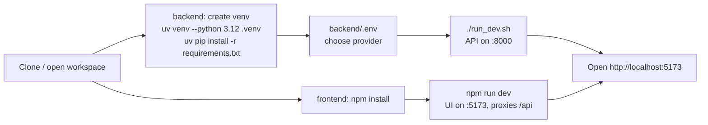
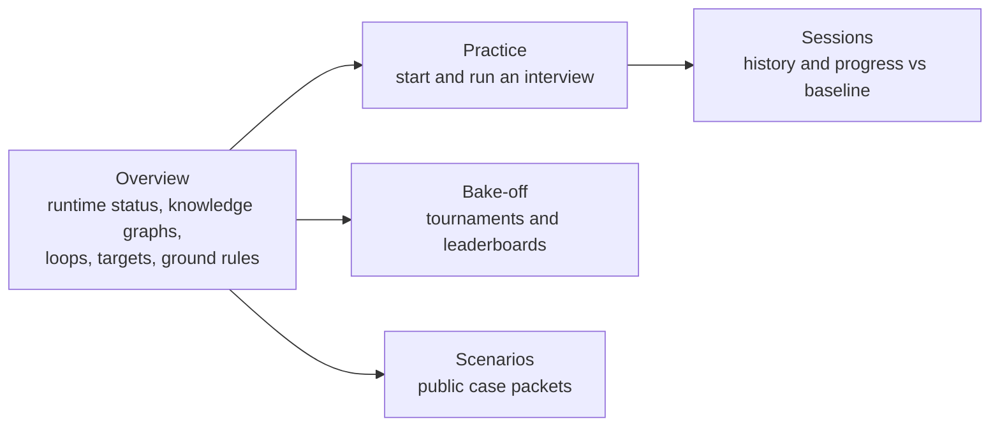
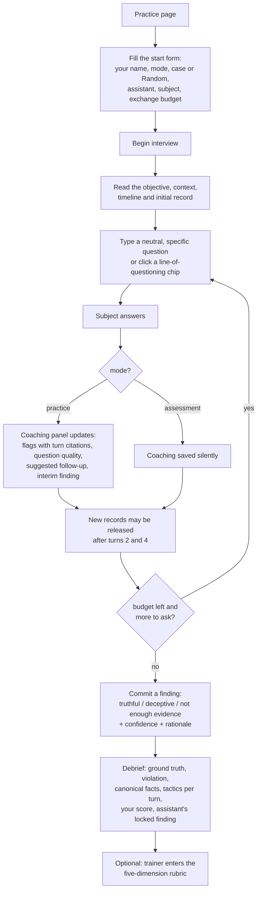
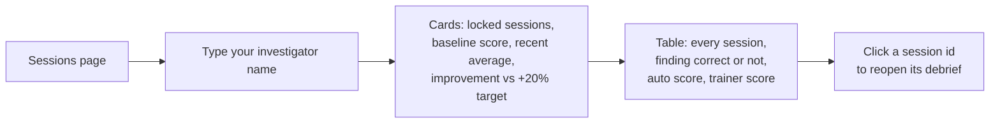
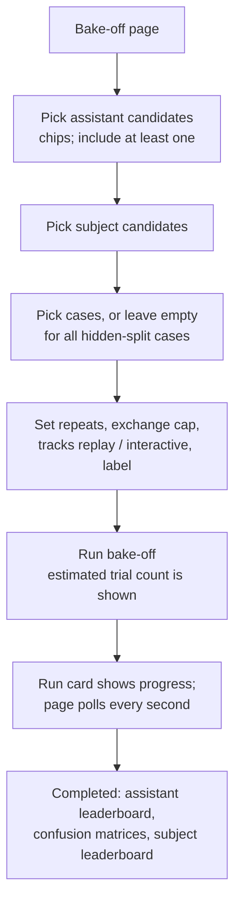
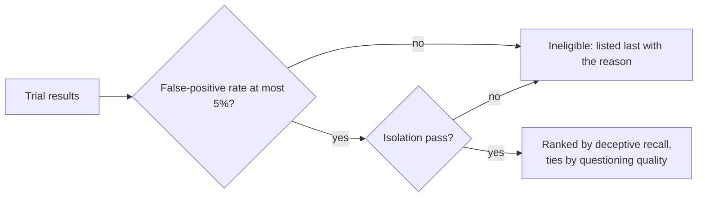

# Using the Investigative AI Training Arena

All cases, people and records are synthetic. A simulated score is never a finding about a real person.

## 1. Setup



Shortcut: `./start.sh` at the project root does all of the above (venv, dependencies, both servers) and `./stop.sh`
stops them. Logs are in `.run/backend.log` and `.run/frontend.log`.

`backend/.env` (copy from `.env.example`):

| Variable | Meaning |
|---|---|
| `ARENA_PROVIDER` | `auto`, `openai_compatible`, `anthropic` or `mock` |
| `ARENA_OPENAI_BASE_URL`, `ARENA_OPENAI_API_KEY`, `ARENA_OPENAI_MODEL` | OpenAI-compatible gateway (challenge default: `gpt-oss-20b`) |
| `ANTHROPIC_API_KEY` | used when provider is `anthropic` |
| `ARENA_DATA_DIR` | where sessions and bake-offs are snapshotted as JSON |

With no credentials the arena runs on deterministic mock agents; every screen still works.

Always start the backend with `./run_dev.sh` (it calls the venv interpreter by path). Check it with:

```bash
curl http://localhost:8000/api/health
```

The Overview page shows the same information as a pill: which runtime and model are active.

## 2. Where everything is



### Knowledge graphs on the Overview page

| Tab | What it shows | Source |
|---|---|---|
| Arena concepts | who sees what: actors, agents, the three scenario packets, records, findings, scorer and gates | static |
| Loops and disciplines | the five nested loops, the four engineering disciplines and the modules they touch | static |
| Case knowledge | objective, timeline, initial records and lines of questioning for a selected case | public packet via `/api/scenarios` |
| Session evidence | turns in order, records released after each, flags pointing at the turn they cite, contradictions linked to the conflicting record, both locked findings against the revealed ground truth | a locked session via `/api/sessions/{id}` |

A numbered flow panel beside each graph narrates the sequence it depicts: the interview lifecycle for Arena concepts, the nested loops for Loops and disciplines, the brief and lines of questioning for the selected case, and the turn-by-turn record of the selected session ending in the locked findings and the revealed ground truth. Each node carries a white tag with the flow step numbers it takes part in (up to three, then "n+"), so the graph and the numbered panel can be read against each other. The panel follows every selection: switching the case or session dropdown rebuilds both the graph and the flow, and clicking a node filters the flow to only the steps that node takes part in (the heading names the selection and offers "Show all steps"). Hover a node for its full text. The Session evidence graph only exists after a finding is locked, so it never reveals a role early.

## 3. Running an interview (practice or assessment)



Tips that the scoring rewards:

- Open each line of questioning with a neutral, open question (what, when, who, walk me through).
- When the assistant flags a point as open, return to it once, then move on and let the records speak.
- When the subject says they do not know, ask for a record that could corroborate rather than treating it as evasion.
- When a released record conflicts with an earlier answer, ask the subject to reconcile it before concluding.
- Choose "not enough evidence" over an unsupported accusation. A false accusation scores zero on closure.

### Reading the coaching panel

| Element | Meaning |
|---|---|
| Green squares under your question | question quality 0 to 4 |
| `possible evasion` / `non responsive` flags | the answer dodged or did not address the question; quoted words and turn number are cited |
| `contradiction` flag | an answer conflicts with a released record or an earlier answer; the record id is cited |
| `explicit uncertainty` flag | the subject said they do not know; this is not evasion |
| Suggested follow-up | click "Use this question" to put it in the input box |
| Interim finding and confidence | the assistant's current, non-binding view |

### Reading the debrief

| Field | Meaning |
|---|---|
| Ground truth role, violation, canonical facts | revealed only now |
| Your finding / assistant's locked finding | green if correct |
| Questioning score (auto proxy) | five dimensions x 0 to 4, x5, from question quality, coverage, follow-up behaviour and closure |
| Evasion flags precision / recall | how the assistant's flags matched the subject's actual tactics |
| Subject behaviour by turn | the hidden tactic the subject used on each exchange |
| Isolation | pass means no private scenario data reached the assistant |

## 4. Tracking your progress



Baseline is your first locked session. "Recent average" is the mean of up to your three most recent sessions after
the baseline.

## 5. Running a bake-off



Sizing guidance: a trial is one interview. With the gateway model the fast assistant takes roughly 30 to 60 s per
4-exchange interview and the rubric-loop assistant several minutes. Start small (2 cases, interactive track) and
grow. Mock baselines are instant and useful as reference rows.

### Reading the assistant leaderboard



| Column | Meaning |
|---|---|
| Deceptive recall (95% CI) | share of deceptive-role trials the assistant called deceptive; CI resampled by case family |
| False-positive rate | share of truthful-role trials called deceptive; unresolved truthful trials stay in the denominator |
| PPV | of all "deceptive" calls, how many were right |
| Unresolved T / D | share of truthful / deceptive trials left as "not enough evidence" (abstention cannot hide poor coverage) |
| Evasion P / R | precision and recall of evasion flags against the subject's own tactic labels |
| Questioning | topic coverage x (1 - unsupported-flag rate); a proxy, calibrate with trainer ratings |
| Unsupported flags | flags with no quote, a non-existent turn, or landing on a truthful turn |
| Latency, cost | per coaching call, published next to rank |

### Reading the subject leaderboard

Truthful and deceptive runs are scored separately. Fidelity is compliant turns / all turns. A deceptive run
"succeeds" only if the violation stayed undetected within the budget while the subject obeyed its profile;
invalid profile behaviour is a fidelity failure, not successful evasion.

## 6. Using the API directly

```bash
# start a practice session on a random case
curl -s -X POST localhost:8000/api/sessions -H 'content-type: application/json' \
  -d '{"investigator":"ana","mode":"practice","assistant_id":"asst-fast-v1","subject_id":"subj-llm-v1","max_turns":8}'

# ask a question
curl -s -X POST localhost:8000/api/sessions/SESSION_ID/ask -H 'content-type: application/json' \
  -d '{"question":"Can you walk me through the evening of 14 March?"}'

# lock a finding and get the debrief
curl -s -X POST localhost:8000/api/sessions/SESSION_ID/finding -H 'content-type: application/json' \
  -d '{"finding":"insufficient_evidence","confidence":0.5,"rationale":"records not yet corroborated"}'

# run a bake-off and poll it
curl -s -X POST localhost:8000/api/bakeoffs -H 'content-type: application/json' \
  -d '{"assistant_ids":["asst-fast-v1","asst-mock-evidence-v1"],"subject_ids":["subj-llm-v1"],"case_ids":["case_B1","case_B2"],"tracks":["interactive"],"max_turns":4}'
curl -s localhost:8000/api/bakeoffs/BAKE_ID?include_results=true
```

Interactive API docs: http://localhost:8000/docs

## 7. Candidates available

| Id | Kind | Runtime | Notes |
|---|---|---|---|
| `asst-evidence-v1` | assistant | deepagents, rubric loop on, medium effort | most careful, slowest |
| `asst-fast-v1` | assistant | deepagents, rubric loop off, low effort | tuned toward the 3-second target |
| `asst-mock-evidence-v1` | assistant | rules | deterministic baseline respecting the FP constraint |
| `asst-mock-aggressive-v1` | assistant | rules | treats uncertainty as evasion; expected to fail the 5% gate |
| `subj-llm-v1` / `subj-llm-medium-v1` | subject | deepagents | plays the private profile at low / medium effort |
| `subj-mock-v1` | subject | scripted | deterministic baseline |

When no credentials are configured, the deepagents candidates show `mock (fallback)` as their effective runtime.

## 8. Troubleshooting

| Symptom | Cause and fix |
|---|---|
| Overview says "mock runtime" although `.env` is set | restart `./run_dev.sh`; the provider is read at startup |
| `ModuleNotFoundError` when running Python by hand | the shell `python` alias bypasses the venv; use `backend/.venv/bin/python` |
| Coaching takes 20 s or more per turn | expected for `asst-evidence-v1` (rubric loop); use `asst-fast-v1` for live practice |
| Bake-off status `failed` | open the run card; the error text is shown. Unknown case or candidate ids are rejected at submit time |
| Assistant rationale begins with `[assistant output invalid` | the model returned invalid JSON twice; the turn degraded to a conservative finding and the error was logged |
