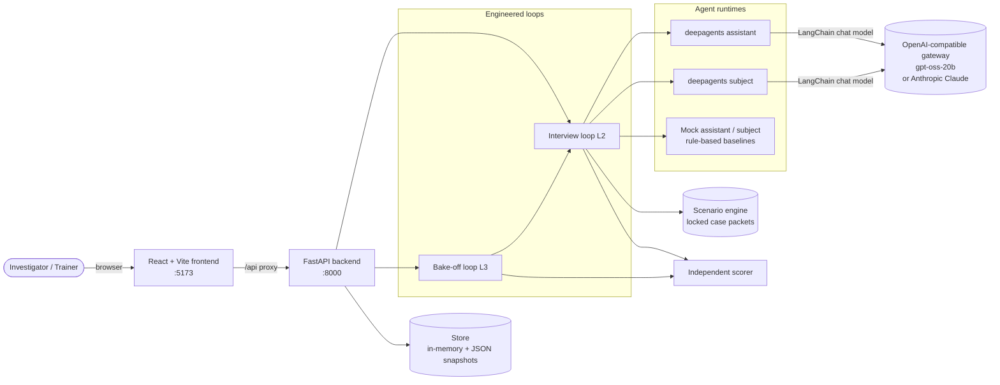
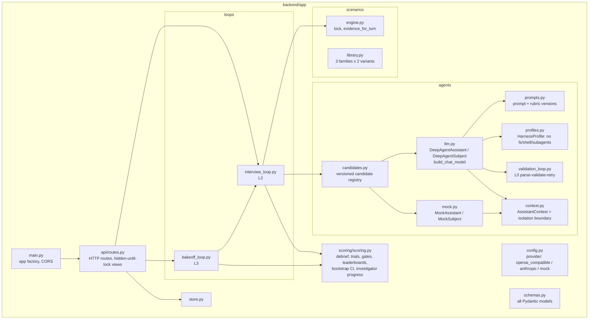
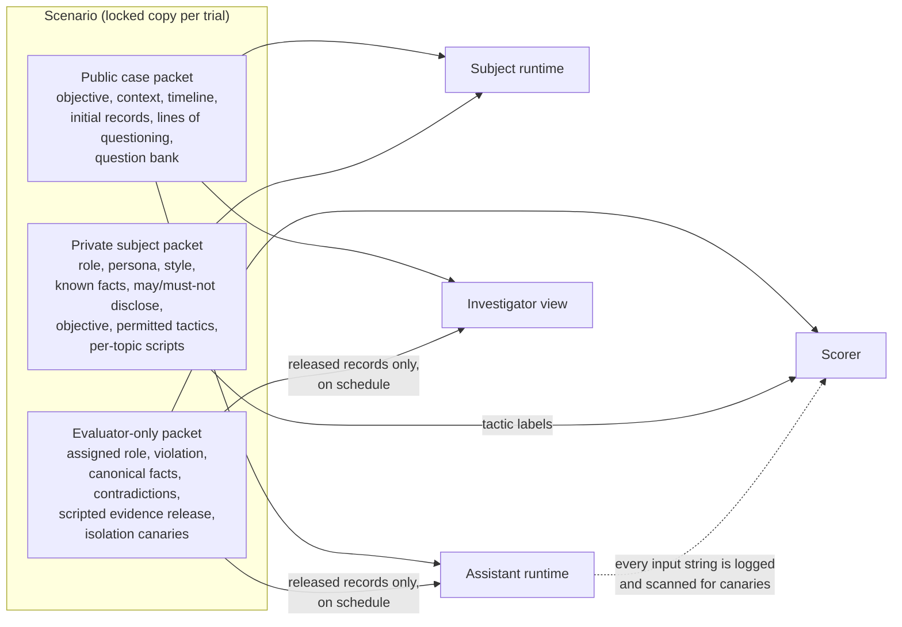
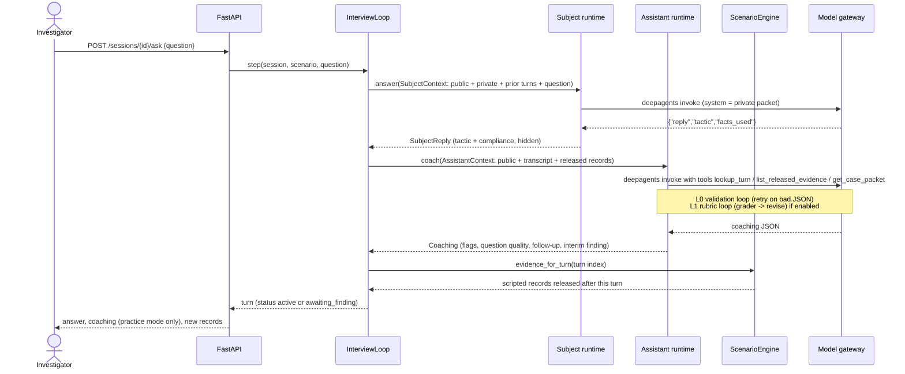
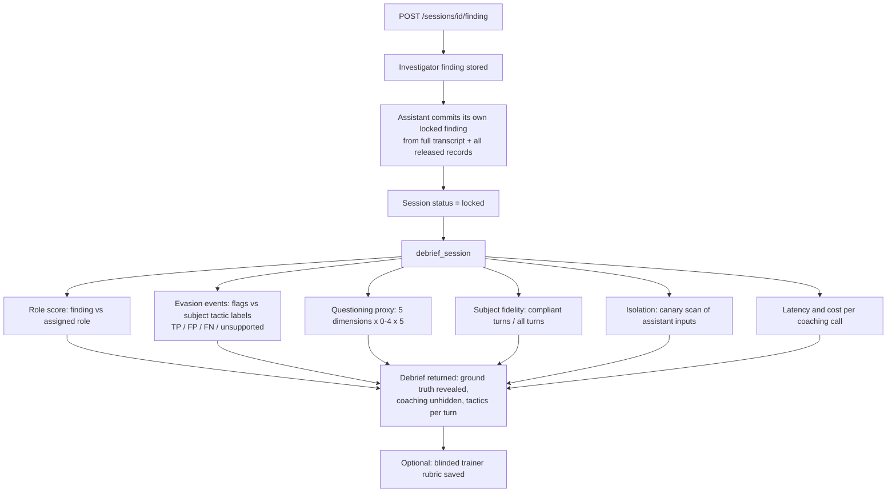
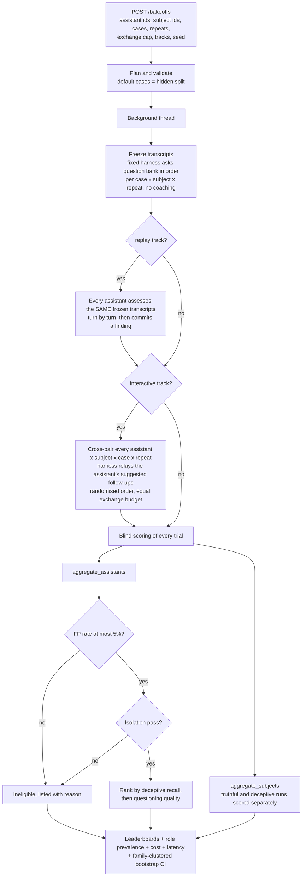
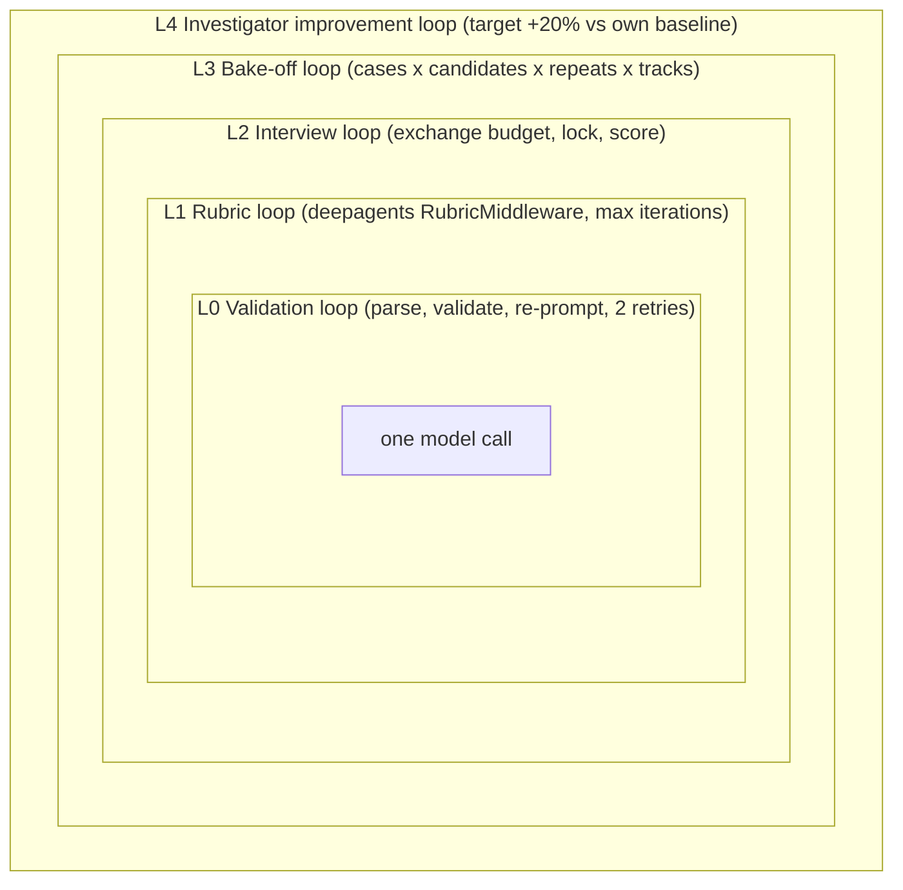

# Architecture

Investigative AI Training Arena: a text-based platform where investigators interview simulated subjects while
competing AI assistants coach them, and where assistants and subjects are compared in blinded bake-offs.

Diagrams are Mermaid; GitHub and the VS Code Markdown preview render them.

## 1. System context

The frontend talks only to the API. The API never exposes a role label, a subject tactic, coaching in assessment
mode, or scoring keys until a finding is locked.

## 2. Code layout

## 3. Scenario packets and the isolation boundary

Every case is one `Scenario` with three packets. Only the public packet and what the interview produces may cross
into an assistant.

`AssistantContext` ([backend/app/agents/context.py](backend/app/agents/context.py)) is constructed only from the
public packet, the transcript and the records released so far. Each string an assistant receives is appended to
`Session.assistant_inputs`; the scorer's isolation check fails a candidate if any evaluator-only canary appears.

## 4. One interview exchange (L2)

The assistant assesses turn *n* with the records released through turn *n-1*. Records scheduled for turn *n* are
released after the assessment, so replayed and live interviews see exactly the same information at each point.

## 5. Locking a finding and scoring

## 6. Bake-off tournament (L3)

## 7. The five engineered loops

| Loop | What iterates | Exit condition | Measurement | Code |
|---|---|---|---|---|
| L0 | model output -> parse -> Pydantic validate -> re-prompt with the error | valid object or 2 retries (then conservative fallback) | retries used | `agents/validation_loop.py` |
| L1 | agent response -> grader verdict against rubric -> revise | `satisfied` or `rubric_max_iterations` | `rubric_iterations`, latency | `RubricMiddleware` in `agents/llm.py` |
| L2 | question -> answer -> assessment -> evidence release -> budget check | finding locked | debrief | `loops/interview_loop.py` |
| L3 | frozen transcripts -> replay -> interactive -> score -> gates -> rank | all planned trials done | leaderboards | `loops/bakeoff_loop.py` |
| L4 | each locked session updates the investigator's score history | never (continuous) | improvement % vs baseline | `scoring.investigator_progress` |

## 8. How the four engineering disciplines are used

| Discipline | Used? | Where |
|---|---|---|
| **Prompt engineering** | Yes | Versioned prompts and rubrics in `agents/prompts.py`: hard rules (demeanor is never evidence, uncertainty is not evasion, prefer insufficient evidence over an unsupported accusation), explicit JSON schema in the prompt, separate rubric for coaching and for the final finding. Subject prompt renders the private packet and the per-topic "if concealing" guidance. |
| **Context engineering** | Yes | `AssistantContext` decides exactly what reaches the assistant each turn: case packet, transcript, the records released so far, and the latest exchange. The evidence-release schedule controls *when* information arrives. Tools (`lookup_turn`, `list_released_evidence`, `get_case_packet`) let the model pull exact text for citations instead of relying on the prompt. The subject's context is its private packet plus the reconstructed conversation history. |
| **Harness engineering** | Yes | deepagents `HarnessProfile` removes the default filesystem, shell and subagent tools (no `ls`, `read_file`, `execute`, `task`); `RubricMiddleware` is attached per candidate policy; `build_chat_model` selects the provider (gateway, Anthropic, mock) and maps the policy's `effort` to `reasoning_effort`; every candidate is a versioned harness configuration (model + prompt version + tools + policy); every assistant input is logged for the isolation audit; validation failures degrade to a conservative finding instead of failing the run. |
| **Loop engineering** | Yes | The five loops above. Budgets, exit conditions and measurements are explicit, and the outer loops (bake-off, investigator progress) are what govern behaviour over time rather than within one call. |

### Mapping to the four canonical loops

Short answer: loops 1 to 3 are implemented; loop 4 is instrumented but not closed.

```mermaid
flowchart TB
    subgraph C4["4. Hill-climbing loop: INSTRUMENTED, improvement step is human"]
        direction LR
        H1[Bake-off trials] --> H2[Leaderboards: recall + clustered CI,<br/>FP rate, evasion P/R, unsupported flags,<br/>cost, latency, per versioned candidate]
        H2 -. manual tuning between tournaments,<br/>development split only .-> H3[New candidate version]
    end
    subgraph C3["3. Event-driven loop: IMPLEMENTED, request-driven"]
        direction LR
        E1[Investigator question<br/>or POST /bakeoffs] --> E2[subject answers] --> E3[assistant assesses] --> E4[scripted evidence release]
    end
    subgraph C2["2. Verification loop: IMPLEMENTED at two levels"]
        direction LR
        V1[L0: schema error fed back<br/>to the model] --> V2[L1: grader model grades<br/>against rubric, agent revises] --> V3[Scorer grades locked finding<br/>against hidden facts, never fed back mid-run]
    end
    subgraph C1["1. Agent loop: IMPLEMENTED by deepagents"]
        direction LR
        A1[model] --> A2[lookup_turn / list_released_evidence /<br/>get_case_packet] --> A1
    end
```

| Canonical loop | In this arena | Status | Notes |
|---|---|---|---|
| **1. Agent loop** (model and tools: act, observe, act again) | Every `coach()` and `answer()` in `agents/llm.py` runs deepagents' act-observe-act cycle: the assistant calls `lookup_turn`, `list_released_evidence` or `get_case_packet`, reads the result and acts again until it emits the coaching JSON. | Implemented | The loop itself is supplied by `create_deep_agent`; it is shaped, not written, here: the harness profile restricts the tool set to those three read-only tools and removes filesystem, shell and subagent tools. |
| **2. Verification loop** (grade the result, retry with feedback) | Inside the agent: `RubricMiddleware` has a separate grader model grade the answer against a rubric and the assistant revises, up to the candidate's iteration cap; the L0 validation loop is the narrower form where the schema error is the feedback. Outside the agent: the independent scorer grades every locked finding against hidden case facts and every flag against the subject's tactic labels. | Implemented at two levels | The scorer's verdict is never returned to the agent mid-run; that separation is what keeps findings blind. Two rubrics exist (coaching, final finding) because one shared rubric made the grader force the wrong schema on the final call. |
| **3. Event-driven loop** (run the agent whenever something happens) | Each investigator question is the event that triggers subject -> assistant -> scripted evidence release (`loops/interview_loop.py`). A bake-off request triggers a background tournament that the UI polls. Evidence release is itself a scripted event stream keyed to turn index. | Implemented, request-driven | No external event bus, scheduler or webhook; events arrive only through the API. |
| **4. Hill-climbing loop** (learn from many runs, improve the system) | The bake-off (L3) produces the signal a climber needs per versioned candidate: deceptive recall with family-clustered confidence intervals, false-positive rate, evasion precision/recall, unsupported-flag rate, cost and latency. L4 tracks each investigator against their own baseline. | Instrumented, not closed | The step that reads traces and rewrites prompts or policies is not automated. Tuning is a human decision between tournaments on the development split only, because hidden-set results must never feed back into a candidate within the same tournament, and an automated climber would make that boundary easy to cross. |

### What is deliberately not used

- No long-term memory or retrieval store: the only "memory" is the locked transcript and the released records,
  because anything else risks leaking role labels across trials.
- No subagents and no filesystem/sandbox tools for the investigative agents: they are excluded by the harness profile.
- No automated prompt rewriting from traces: tuning between tournaments is manual so that hidden-set performance
  can never feed back into a candidate inside the same tournament.
